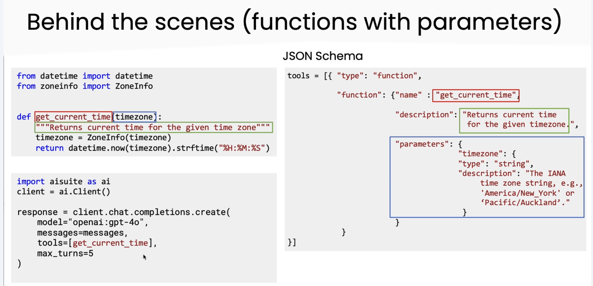

## Final Takeaways

- Tool calling lets LLMs go beyond text generation—they can now use functions as part of their reasoning.
- Clear, well-documented functions (with precise docstrings) help the model know when and how to use each tool.
- AISuite handles the complexity of translating python functions into tool schemas and orchestrating multi-step workflows.
- Choosing the right model matters: smaller models are faster and cheaper for simple tasks, while stronger models are better for reasoning-heavy workflows.
- Watching the conversation flow (prompts, tool calls, results, final response) is essential for debugging and improving agentic behaviors.
